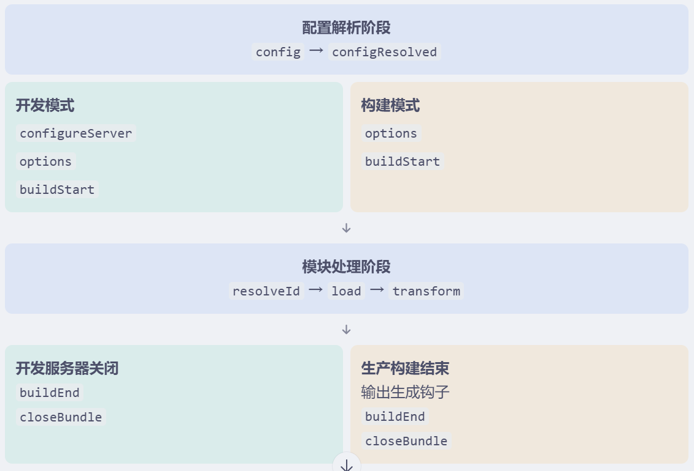
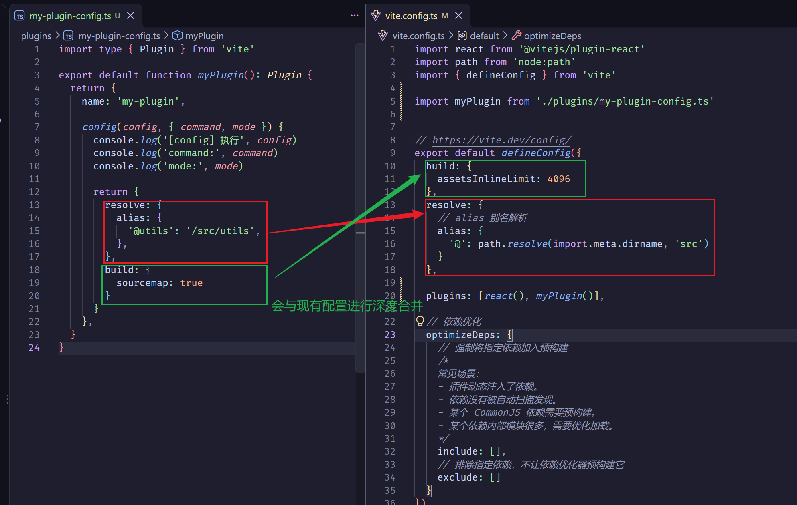

## 插件

### 插件基础

### 关键机制
  - resolveId 是 first-result-wins（第一个有效结果优先）的钩子。
    第一个返回非空解析结果的插件会结束这次 resolveId 插件链
  - load 第一个有效结果(no-null)生效

```js
const pluginA = {
  name: 'plugin-A',

  resolveId(source) {
    console.log('A:', source)
    return null
  },
}

const pluginB = {
  name: 'plugin-B',

  resolveId(source) {
    console.log('B:', source)

    if (source === 'virtual:hello') {
      return '\0virtual:hello'
    }

    return null
  },
}

const pluginC = {
  name: 'plugin-C',

  resolveId(source) {
    console.log('C:', source)
    return null
  },
}
```
### 插件执行顺序
- Alias
- 带有 enforce: 'pre' 的用户插件
- Vite 核心插件
- 没有 enforce 值的用户插件
- Vite 构建用的插件
- 带有 enforce: 'post' 的用户插件
- Vite 后置构建插件（最小化、manifest、报告）

### 类型校验
`import type { Plugin } from 'vite'`

Cannot find module '@/component/Button' or its corresponding type declarations.
`"paths": {
      "@/*": ["./src/*"]
    },
`

### load
返回值：
- null: 当前插件不负责加载这个模块。继续交给后续插件处理；如果没有插件接管，Vite 会使用自己的默认加载逻辑
- 返回字符串: 当前插件直接提供模块源码
- 返回对象：
```js
load(id) {
  if (id.endsWith('/Button.tsx')) {
    return {
      code: `
        export default function Button() {
          return 'Hello'
        }
      `,
      map: null,  // Source Map，用于建立转换后代码与原始代码之间的映射关系
    }
  }

  return null
}
```

### transform    transform 是一个连续的代码转换链。每个插件都可以接收前一个插件提供的代码，并决定是否继续转换。

#### 返回值：
- null:不处理，交给后续插件
- undefined: 不处理，交给后续插件
- 字符串:	返回转换后的源码
- { code, map }:	返回源码和 Source Map

#### 短路机制
-


### Order  Enforce
- order 不会把整个插件移动到 pre 组，它只影响对应钩子


### 虚拟模块（Virtual Modules)

虚拟模块的核心思想：模块存在于 Vite 的模块处理系统中，但不一定对应磁盘上的真实文件。

常见应用场景：
- 自动生成项目配置。
- 自动生成路由表。
- 自动收集项目中的组件。
- 自动生成权限配置。
- 注入运行时环境信息。
- 读取配置文件并生成统一模块。

virtual:my-config	   开发者在业务代码中导入的名称
\0virtual:my-config	 插件内部使用的模块 ID

什么要加 \0？

它是插件生态中的约定，用来告诉 Vite/Rolldown：这是一个虚拟模块，不是普通文件路径。

这样可以避免后续普通文件解析逻辑错误地处理它，也方便框架区分虚拟模块和真实文件。

Vite 开发环境会将内部的 \0 ID 编码成浏览器可请求的 URL，例如 /@id/__x00__virtual:my-config，进入插件钩子之前再恢复

### 插件调试

- Vite 插件提供了插件上下文，可以通过它输出警告或终止当前构建处理。
  >`this.warn()`	输出警告，通常不会中断构建
  >`this.error()`	抛出插件错误，中断当前处理流程

### 插件生命周期

Vite 插件生命周期可以分为三个阶段：
1. 配置解析阶段
2. 开发服务器或构建初始化阶段
3. 模块处理与结束阶段





- 配置解析阶段
> config:  修改配置  Vite 会将返回的配置与现有配置进行深度合并

> resolvedConfig:  读取最终的配置

- 开发服务器初始化阶段
> configureServer:  只在开发服务器启动时调用, 生产构建不会调用
> 主要用于获取开发服务器实例，以及注册中间件

插件之间的顺序：看解析后的插件顺序。
前置和后置的相对位置：看是否通过返回函数注册。
请求是否继续向后执行：看中间件有没有调用 next()

configureServer 执行时，Vite 内部中间件尚未全部安装

** 前置中间件:直接调用 server.middlewares.use()：注册的中间件位于 Vite 内部中间件之前。**
```js
/*
适合：
- 拦截特定请求。
- 自定义 API 接口。
- 在 Vite 处理请求之前进行权限检查。
- 记录请求日志。
*/
configureServer(server) {
  server.middlewares.use((req, res, next) => {
    console.log('[前置中间件]', req.url)
    next()
  })
}
```
** 后置中间间: 从 configureServer 返回一个函数, 这个函数会在 Vite 内部中间件安装完成后执行，可以在其中注册后置中间件。**

```js
configureServer(server) {
  return () => {
    server.middlewares.use((req, res, next) => {
        console.log('[前置中间件]', req.url)
        next()
      })
  }
}
```

- 模块处理阶段
resolveId	   模块解析时	     解析模块 ID
load	       模块加载时	     获取模块源码
transform	   模块转换时	     修改模块源码

- 开发服务器关闭 生产构建结束

buildStart: 构建流程开始时调用。在 Vite 开发模式中，也会在开发服务器启动时调用一次。
常用于：
- 初始化插件状态。
- 读取项目文件。
- 初始化缓存。
- 准备构建所需的数据。
buildEnd: 构建结束时调用，适合做收尾处理。
closeBundle: 构建结束或开发服务器关闭时调用，适合清理资源。
Vite 8 的开发服务器中，Rolldown 钩子 options、buildStart 在服务器启动时调用；服务器关闭时会调用 buildEnd、closeBundle


